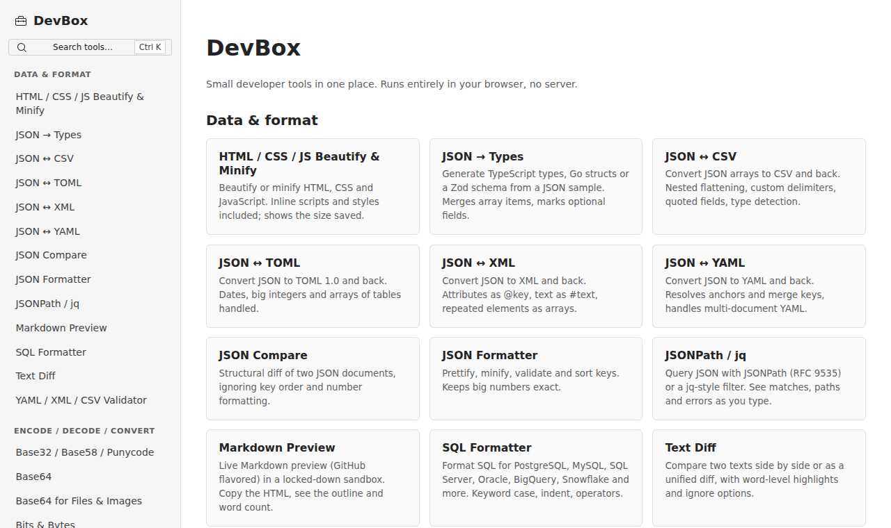
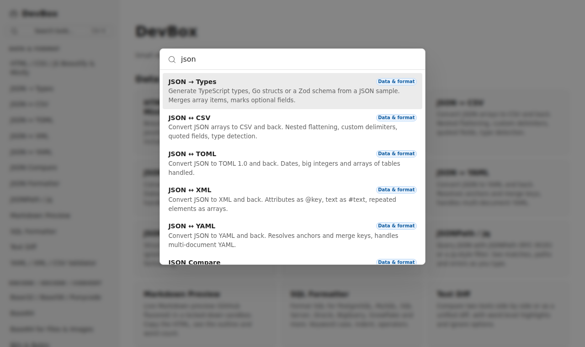
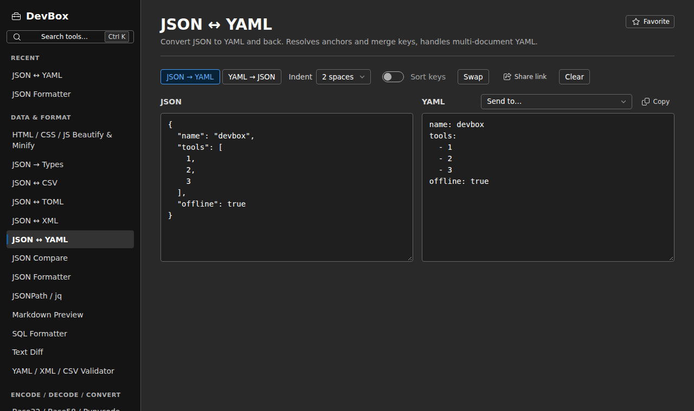

# DevBox

**A collection of small developer tools in one place — 100% client-side in your browser.**

Everything runs locally in your browser. There is no backend, no telemetry, and no data leaves your machine.

[](https://github.com/psudocode/devbox/actions/workflows/ci.yml)

**[Live demo → dev.awdi.my.id](https://dev.awdi.my.id)** · [Roadmap](./TODO.md) · [Report a bug](https://github.com/psudocode/devbox/issues/new)



| Command palette (`Ctrl+K`) | Pipeline: JSON → YAML, dark mode |
| --- | --- |
|  |  |

---

## Highlights

- **100% Client-Side:** All parsing, formatting, conversion, and cryptography run in the browser (using Web APIs like `crypto.subtle` wherever possible).
- **Fast Navigation:** Command palette (`Ctrl+K` / `Cmd+K`), search, favorites, and recently used tools.
- **Tool Pipelines:** Send output from one tool directly into another (`SendToMenu`), plus shareable state via URL hash (`#/tool-id`).
- **Offline Ready:** Installable PWA with service worker caching and persistent tool state in `localStorage`.
- **Dark & Light Theme:** Follows system preference with manual override.

## Included Tools

### Data & Format
- JSON formatter / prettify, minify, validate, sort keys
- JSON compare / diff
- JSON ↔ YAML, CSV, XML, TOML
- JSON → TypeScript types / Go struct / Zod schema
- JSONPath / jq-style query tester
- YAML / XML / CSV validator and formatter
- SQL formatter, Markdown preview, HTML / CSS / JS beautify & minify, Text diff

### Encode / Decode / Convert
- Number base converter (hex, binary, decimal, octal, arbitrary base 2–36 via `BigInt`)
- Base64 (text & URL-safe), Base64 for files/images ↔ data URI
- Base32, Base58, Punycode
- URL encode/decode, HTML entities, Unicode escape (`\uXXXX`)
- Text ↔ hex / binary / ASCII + ASCII/Unicode table
- Bit / byte tools (endianness, bit flags, two's complement)

### Security & Crypto
- JWT decoder, JWT sign & verify (`HS256`, `RS256`, `ES256`)
- Hash generator (`MD5`, `SHA-1`, `SHA-256`, `SHA-384`, `SHA-512`, `HMAC`)
- UUID v4/v7, ULID, NanoID generators
- AES encrypt / decrypt
- RSA / ECDSA / Ed25519 key pair generator & PBKDF2

### Time, Web & Frontend
- Unix timestamp ↔ date (seconds/ms, timezone-aware)
- Regex tester (match highlight, groups, flags)
- Color converter (`HEX` / `RGB` / `HSL` / `OKLCH`) + WCAG contrast checker

> See [`TODO.md`](./TODO.md) for upcoming tools in Phase 2 and Phase 3.

## Architecture

| Piece | Where | What it does |
| --- | --- | --- |
| Tool registry | `src/tools/registry.ts`, `registry-core.ts` | One list of tool definitions (id, name, category, keywords, lazy component). Sidebar, home grid, search and command palette are all generated from it. `createRegistry` rejects invalid or duplicate ids. |
| Logic / UI split | `src/tools/<id>/logic.ts` + `index.tsx` | `logic.ts` holds pure, unit-tested functions with no React or DOM. `index.tsx` is a thin UI over them. |
| Pipeline | `src/lib/pipeline.ts`, `usePipeline.ts` | One-slot, in-memory handoff. A tool with `acceptsText` appears in other tools' "Send to…" menu and receives the value via `usePipelineInput`. |
| State | `src/lib/toolState.ts`, `useToolState.ts` | Per-tool input persisted in `localStorage` and encoded as base64url in the URL hash for share links. |
| Routing | `src/lib/router.ts` | Hash router (`#/tool-id`), so it works on any static host. |
| Offline | `vite-plugins/service-worker.ts` | Build-time service worker plus web manifest, making DevBox an installable PWA. |

## Design decisions

- **No backend, ever.** Inputs (tokens, keys, payloads) are sensitive, so nothing is uploaded and there is no telemetry. This also makes hosting a static site on Cloudflare Pages.
- **Pure logic, separate from UI.** Tool behavior is tested in Vitest's Node environment without rendering anything, which keeps the suite fast and the UI layer trivial.
- **Registry as the single source of truth.** Adding a tool is one registry entry; navigation and search need no further wiring.
- **Lazy-loaded tools.** Each tool is its own chunk, so heavy dependencies (WASM hashing, beautifiers, SQL formatter) load only when opened.
- **Pipeline stays in memory.** Sent data never touches storage or the URL, so it cannot outlive the page.
- **Web APIs first.** `crypto.subtle`, `TextEncoder`, `Intl` and `BigInt` are preferred; a dependency is added only when it clearly pays off (see [`TODO.md`](./TODO.md)).
- **Relative Vite `base` and hash routing**, so the same build works from any path or static host.
- **Strict CI gate:** lint with `--max-warnings 0`, tests, and type-checked build on every PR.

## Tech Stack

TypeScript · React 18 · Vite · Fluent UI (`@fluentui/react-components`) · Vitest · GitHub Actions · Cloudflare Pages

## Getting Started (Development)

**Requirements:** Node.js 20+ and npm

```bash
git clone https://github.com/psudocode/devbox.git
cd devbox
npm install
npm run dev       # start the dev server
```

### Scripts

| Command | What it does |
| --- | --- |
| `npm run dev` | Start the Vite dev server |
| `npm run lint` | Run ESLint (`--max-warnings 0`) |
| `npm test` | Run unit tests (Vitest) |
| `npm run build` | Type-check (`tsc`) + production build into `dist/` |
| `npm run preview` | Serve the production build locally |

## Adding a Tool

1. Create `src/tools/<tool-id>/logic.ts` (pure functions) with `logic.test.ts`, and `index.tsx` (default-exported UI component).
2. Register it in `src/tools/registry.ts` with `component: lazy(() => import('./<tool-id>'))`.
3. Reuse shared UI from `src/components/ui` (`TextPane`, `CopyButton`, `FileDropZone`, `ErrorDisplay`, `ShareButton`, `SendToMenu`), `useToolState(toolId, defaults)` for persisted + shareable state, and `usePipelineInput(toolId, cb)` if the tool sets `acceptsText`.

## Roadmap

See [`TODO.md`](./TODO.md) for the full checklist and conventions.
